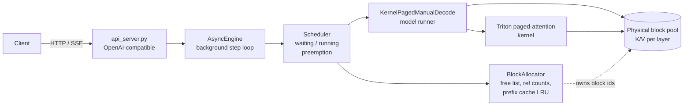

# Paged-KV Inference Engine

A from-scratch, mini-vLLM-style LLM serving engine: a block-based (paged) KV-cache allocator, a Triton paged-attention kernel, an iteration-level continuous-batching scheduler with preemption, prefix caching, and an OpenAI-compatible streaming API. It runs Qwen2.5-0.5B-Instruct on a single consumer GPU and is evaluated against a static-allocation baseline under an equal KV-memory budget.

This is a learning-and-measurement project, not a production server. The goal was to build each layer, verify it against a reference, and report what the measurements do and do not show, including the negative results.

## Why this exists

Static KV-cache allocation reserves memory for the longest possible sequence in every slot, so most of the reserved memory sits empty. Paging the cache into fixed-size blocks, as OS virtual memory does, lets sequences use memory in proportion to their actual length. Under a fixed KV budget that means more concurrent sequences, and in turn more throughput once the system is memory-bound.

## Architecture



| Component | Path | What it does |
|---|---|---|
| Block allocator | `engine/memory/block_allocator.py` | Free-list allocator over fixed-size blocks, reference counts, optional prefix cache (chain-keyed immutable blocks, LRU "cached-free" pool), `check_invariants()` |
| Physical pool | `engine/memory/block_allocator.py` | One K and V tensor per layer, `[num_blocks, block_size, kv_heads, head_dim]`, sized from a memory budget |
| Triton kernel | `engine/kernels/paged_attention.py` | Decode attention that reads K/V through a block table: two-pass (v1), online-softmax (v2), batched with GQA |
| Model integration | `engine/kernels/paged_attention_integration.py` | Patches Qwen2 attention layers to write new K/V into blocks and call the kernel; prefill and decode steps |
| Scheduler | `engine/scheduler/continuous_batching.py` | Iteration-level scheduling, admission with watermark, LIFO recompute preemption, prefix-cache admission, per-step invariant checks. The scheduler is the only component that allocates or frees blocks |
| Async engine | `engine/serving/async_engine.py` | One background loop; model work runs in an executor so the event loop stays responsive; cancellation frees blocks at the next step |
| API server | `engine/serving/api_server.py` | `/v1/completions` (streaming and non-streaming), `/health`, `/metrics`; rejects oversized requests with HTTP 400 |
| Baseline | `engine/serving/naive_server.py`, `engine/baseline/` | Static-cache, request-level batching server and Phase 0 decode loops used as the control |

## Setup

Developed on Windows 11 with an NVIDIA RTX 4060 Laptop GPU (8 GB), Python 3.10, PyTorch 2.x with CUDA 12.4, `triton-windows`, and `transformers` 5.x. Linux or WSL2 with upstream Triton should also work. Anything past the CPU tests needs a CUDA GPU.

```bash
python -m venv .venv && source .venv/bin/activate
pip install -r requirements.txt
```

Run the server (see `engine/serving/api_server.py` for the budget and mode environment variables):

```bash
uvicorn engine.serving.api_server:app --port 8000
curl -s localhost:8000/v1/completions -H "Content-Type: application/json" \
  -d '{"prompt": "The capital of France is", "max_tokens": 16, "temperature": 0}'
```

The official `openai` Python client works unmodified against `/v1`.

## Testing

Every layer was checked against a simpler reference before the next was built.

```bash
pytest tests/test_block_allocator.py tests/test_scheduler_continuous_batching.py \
       tests/test_paged_attention_prefix_cache.py -q          # CPU only
pytest tests/test_paged_attention_reference.py -q             # needs CUDA for the Triton cases
pytest tests/test_real_gpu_three_tests.py -q                  # real model, needs a GPU
python -m scripts.diagnose_kv_equivalence                     # cached K/V vs recomputed K/V
```

- **Allocator:** a fixed-seed randomized state-machine test (thousands of allocate/register/acquire/release/lookup operations against a reference model) with `check_invariants()` after every operation.
- **Scheduler:** fake-model tests for leaks, slot reuse, preemption under a tiny pool, prefix sharing, and eviction; a debug mode checks block conservation and reference counts every iteration.
- **Kernel:** compared to a PyTorch reference on randomized, shuffled, non-contiguous block layouts, including GQA ratios of 1, 2, 4 and 7, partial last blocks, 2048-token sequences, and large-magnitude scores.
- **End to end:** greedy output compared to Hugging Face on a real model, with the first divergence and the top-1/top-2 logit margin reported for any mismatch.

## Results

All numbers are from one laptop GPU, one 0.5B model, greedy decoding, and synthetic Poisson traces with fixed output lengths. Throughput and latency numbers depend on the trace. Treat the ranges as the finding, not any single run.

### Correctness

- Cached K/V blocks are bitwise identical to freshly computed K/V (max absolute difference 0 across all 24 layers).
- Paged decode matches Hugging Face greedy output except at fp16 near-ties. Over 64 tokens on 5 prompts, 3 matched exactly. The other 2 diverged at steps 13 and 53 where the top-1/top-2 logit margin was about 0.03, and teacher-forced logit differences stayed within fp16 noise. In batched, preempted and prefix-cached runs, every mismatch had a near-tie margin.

### Kernel

- Correct against the reference across the cases listed above.
- Compared with PyTorch's memory-efficient SDPA on contiguous K/V with GQA heads pre-expanded: roughly even at batch sizes 1 to 4 (0.8 to 1.4x) and 2.3 to 2.7x faster at batch 16 and above. A GQA-native kernel reads about 7x fewer K/V bytes than the expanded baseline, so part of this gain is memory traffic rather than a better algorithm. `[TODO: rerun this comparison with the L2 cache flushed so all rows use one methodology.]`
- Peak effective bandwidth with L2 flushed: about 81 GB/s at batch 32 and sequence length 2048, roughly 36% of the 227 GB/s this GPU achieves for a plain 256 MB copy. There is headroom: the kernel launches one program per query head, so each KV block is read once per query head in its GQA group.
- At small batch sizes the kernel is limited by occupancy and per-step overhead, not bandwidth.

### Serving at equal KV budget

Both servers get the same 9 MiB KV budget (768 tokens): the static server has 3 slots of 256 tokens, and the paged server has 48 blocks of 16 tokens. Both run the same Hugging Face forward under `torch.inference_mode()`.

| | Static batching | Paged, capped at 3 concurrent | Paged |
|---|---|---|---|
| Throughput at saturation, λ = 3 to 4 (tok/s) | 43 to 49 | 40 to 43 | 56 to 66 |
| TTFT P99, λ = 3 to 4 (s) | 1.0 to 2.3 | 1.2 to 2.5 | 0.4 to 0.7 |

- Below saturation (λ of 2 req/s and under) the systems are indistinguishable: throughput matches offered load and tail latency is a fraction of a second.
- The saturation gap is **about 1.2 to 1.5x** across two seeds. It comes from concurrency: capping the paged engine at the static server's 3 concurrent sequences removes the gain.
- Decode step time is roughly flat from batch 1 to 8 on this setup (around 45 ms, launch-bound), so throughput tracks the number of concurrent sequences. The paged runner is slower than plain Hugging Face at batch 3 to 8 (0.93, 0.90 and 0.75x), which is one reason the gain is less than the concurrency ratio.
- Seeds are reported separately in `benchmarks/results/`. Several points sit close to the saturation boundary, where run-to-run variation is large.

### Prefix caching

Chain-keyed, immutable full blocks; freed cached blocks go to an LRU pool and are evicted only when needed; at least one prompt token is always recomputed. Budget 768 tokens unless noted.

| Workload | Saturated throughput gain (share / off) | First-admission hit rate (measured / ceiling) |
|---|---|---|
| 1 shared 64-token prefix | 1.24 to 1.28x | 55.8% / 56.1% |
| 4 shared prefixes | 1.07 to 1.48x across 4 runs (inconclusive) | 48.3% / 50.6% |
| 16 prefixes, pool thrashes (768 tokens) | 1.03 to 1.10x | 4.0% / `[TODO: per-profile ceiling]` |
| 16 prefixes, 4096-token pool | 1.36x (one seed, at offered load, so a lower bound) | about 50% |
| 200 unique prefixes (control, 0% hits) | `[TODO: rerun at a saturating load]` | 0% by construction |

- The gain scales with how much memory sharing saves and shrinks when the cache thrashes.
- Skipping the shared prefill computation (`full` mode) gave **no measurable benefit** over memory sharing alone (`share`). On this launch-bound 0.5B model a 489-token prefill costs about as much as a decode step (about 54 ms), and an 8-token suffix forward is not faster.
- An early version of these experiments reported 1.7x and a 485x TTFT improvement. Both were artifacts: the first compared a throttled plateau against an offered-load-capped one, and the second compared queueing delay under overload. They are retracted here and kept in the notes below.

## Bugs found and how they were found

**Autograd left enabled in the baseline server.** The first version of the static baseline lost most requests after about ten batches with CUDA out-of-memory. Per-batch `memory_allocated` climbed from 957 MiB to about 14 GiB. Four single-change variants (`logits_to_keep=1`, `empty_cache()` between batches, a cache-overflow guard, and a one-batch log) all failed identically, which ruled out logits size, allocator caching and cache overflow. Wrapping the batch in `torch.inference_mode()` held memory flat at about 965 MiB across 52 batches with zero failures. The graph for every forward pass had been retained for a backward that never ran.

**Fast tokenizer is not thread-safe.** Rare HTTP 500s on the baseline came from `RuntimeError: Already borrowed`: the request handler and the executor thread both mutated one tokenizer's padding state. Fix: tokenize once in the handler and build padded batches from token ids.

**Admission mismatch.** A request needing 38 blocks reached a 37-block pool and crashed the engine loop. The handler now rejects oversized requests with HTTP 400, the engine fails a single offending sequence instead of exiting, and every benchmark run asserts that the server's reported block count equals the run's intended capacity.

**Measurement pitfalls that nearly produced wrong claims:** an SDPA baseline that silently used the math fallback; a bandwidth figure inflated by L2 cache residency; throughput that equalled offered load being read as a plateau; TTFT percentiles under overload that measured run length; a "no-sharing" control that shared first blocks through a small prompt vocabulary.

## Limitations

- One small model (0.5B), one laptop GPU, greedy decoding only. At this size the forward pass is launch-bound, which hides compute savings and compresses gains from batching. Results may differ substantially on larger, memory-bound models.
- Preemption is recompute-only; there is no swap-to-CPU path.
- Prefill is not batched with decode and runs through the Hugging Face path.
- Traces are synthetic with fixed output lengths; real workloads with early stopping, long-tail lengths, or multi-turn reuse were not evaluated.
- The kernel is correct but not tuned to the bandwidth limit; a GQA-grouped launch and FlashDecoding-style sequence splitting are the obvious next steps.
- GPU clocks varied during long benchmark sessions on a laptop. Mode order was interleaved within each cell, but the spread between seeds is large for several points.

## Repository layout

```
engine/            allocator, kernels, scheduler, serving
benchmarks/        workload traces, load generator, serving and prefix-cache sweeps, figures
tests/             unit, invariant, kernel and real-GPU tests
scripts/           diagnostics (K/V equivalence, pool sizing, Triton check)
```

## References

- Kwon et al., *Efficient Memory Management for Large Language Model Serving with PagedAttention* (SOSP 2023).
- Yu et al., *Orca: A Distributed Serving System for Transformer-Based Generative Models* (OSDI 2022).
- Dao et al., *FlashAttention* (2022), for the online-softmax formulation used in the kernel.

## License

This project is released under the [MIT License](LICENSE). Copyright (c) 2026 [Tanmmay kanahaiya].

Third-party components (PyTorch, Hugging Face Transformers, Triton, FastAPI and others) are used under their own licenses. Qwen2.5-0.5B-Instruct model weights are distributed under their own license terms; check the model card before redistributing them or using them commercially.