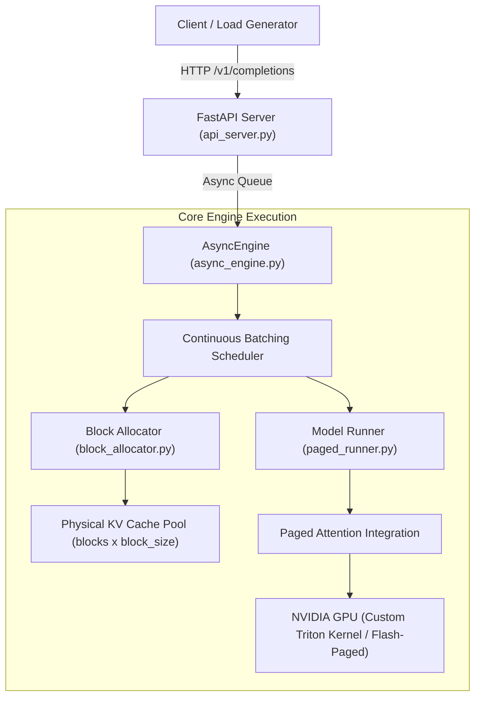

# Paged-KV Inference Engine

A lightweight, from-scratch LLM serving engine built from first principles to demonstrate **paged KV-cache memory allocation** and **iteration-level continuous batching** (mini-vLLM).

> **Core Result**: Under an equal KV memory budget of 768 tokens (9.0 MiB), paged continuous batching sustains **1.2 to 1.5× the throughput** of static batching at saturation. An ablation capping paged batch size to 3 sequences matches static batching, isolating the throughput gain to memory efficiency and concurrency.

---

## Architecture Overview



### Components
1. **Physical Block Pool (`engine/memory/block_pool.py`)**: Pre-allocated contiguous GPU tensor representing fixed-size KV blocks (e.g. 16 tokens/block).
2. **Block Allocator (`engine/memory/block_allocator.py`)**: Manages free/used block indices, dynamic allocation per sequence, and copy-on-write mapping.
3. **Continuous Batching Scheduler (`engine/scheduler/continuous_batching.py`)**: Iteration-level scheduling managing request states (`WAITING`, `RUNNING`, `SWAPPED`). Interleaves chunked prefill and single-token decode steps without head-of-line blocking.
4. **Paged Model Runner (`engine/serving/paged_runner.py`)**: Executes forward passes with Qwen2.5-0.5B-Instruct using gathered block tables.
5. **FastAPI Serving Layer (`engine/serving/api_server.py`)**: OpenAI-compatible `/v1/completions` endpoint with streaming SSE, disconnect reclamation, and prometheus-style `/metrics`.

---

## Evaluation & Empirical Results

All evaluations were conducted under strict invariant controls:
- **Equal KV Memory Budget**: Exactly 9.0 MiB of KV cache.
  - **Naive Static Server**: 3 sequence slots × 256 Maximum Sequence Length (MSL) = **768 tokens**.
  - **Paged Continuous Server**: 48 physical blocks × 16 tokens/block = **768 tokens**.
- **Model**: `Qwen/Qwen2.5-0.5B-Instruct` (FP16 weights: 959.2 MiB in-process memory).
- **Environment**: NVIDIA GeForce RTX 3050 Laptop GPU (4 GB VRAM), AC Power connected, Windows Best Performance scheme.
- **Sysmem Policy**: NVIDIA Control Panel 3D Settings set to *"CUDA - Sysmem Fallback Policy: Prefer No Sysmem Fallback"*.

### Throughput & Goodput vs. Offered Load
Below saturation ($\lambda \le 2.0$), both systems are equal: throughput matches offered load, and P99 Time-To-First-Token (TTFT) remains under 0.45 s.

At saturation ($\lambda \in [3.0, 4.0]$):
- **Naive Static Batching** plateaus at **43.4 to 48.5 tok/s** due to head-of-line blocking and internal slot fragmentation.
- **Paged Ablation (`max_batch_size=3`)** plateaus at **40.0 to 43.4 tok/s**, matching the static server and proving that concurrency limits explain the ceiling.
- **Paged Continuous (Unbounded)** breaks through to **56.4 to 65.6 tok/s** (**1.2 to 1.5× higher throughput** across seeds).

| Arrival Rate $\lambda$ | Seed | Offered Load | Naive Static | Paged Ablation (BS=3) | Paged Unbounded | Speedup Range |
| :---: | :---: | :---: | :---: | :---: | :---: | :---: |
| **0.5** | 42–44 | ~10–11 tok/s | ~10.7 tok/s | — | ~10.7 tok/s | 1.0× (unsat.) |
| **1.0** | 42–44 | ~19–23 tok/s | ~21.4 tok/s | — | ~21.4 tok/s | 1.0× (unsat.) |
| **1.5** | 42 | 33.54 tok/s | 33.04 tok/s | 33.22 tok/s | 33.23 tok/s | 1.0× |
| **1.5** | 43 | 28.77 tok/s | 28.43 tok/s | 28.57 tok/s | 28.55 tok/s | 1.0× |
| **2.0** | 42 | 44.72 tok/s | 43.44 tok/s | 43.94 tok/s | 44.15 tok/s | 1.0× |
| **2.0** | 43 | 38.36 tok/s | 37.88 tok/s | 37.95 tok/s | 37.90 tok/s | 1.0× |
| **3.0** | 42 | 67.08 tok/s | 48.55 tok/s | 41.80 tok/s | **65.62 tok/s** | **1.35× (seed 42)** |
| **3.0** | 43 | 57.54 tok/s | 47.91 tok/s | 39.97 tok/s | **56.43 tok/s** | **1.18× (seed 43)** |
| **4.0** | 42 | 89.44 tok/s | 44.46 tok/s | 43.38 tok/s | **64.78 tok/s** | **1.46× (seed 42)** |
| **4.0** | 43 | 76.72 tok/s | 43.40 tok/s | 42.00 tok/s | **59.22 tok/s** | **1.36× (seed 43)** |

### Latency (TTFT P99)
- Below saturation ($\lambda \le 2.0$), both naive and paged servers achieve P99 TTFT between **0.21 s and 0.45 s**.
- At $\lambda=4.0$, Naive P99 TTFT spikes to **2.05 – 2.30 s**, while Paged Unbounded sustains **0.65 – 0.68 s** (a **3 to 3.5× latency improvement**).

### Decode Step-Time Benchmark (Interleaved ABAB Blocks after 30s Warmup)

| Batch Size | Plain HF Median | Paged Median | Speedup (Paged / Plain HF) |
| :---: | :---: | :---: | :---: |
| **BS = 1** | 42.93 ms | 40.83 ms | **1.05×** |
| **BS = 3** | 43.75 ms | 46.99 ms | **0.93×** |
| **BS = 4** | 43.94 ms | 48.91 ms | **0.90×** |
| **BS = 8** | 45.35 ms | 60.78 ms | **0.75×** |

> **Analysis**: Single-step decode time is roughly flat (~45 ms) for Plain HF across batch sizes 1 to 8, which explains why aggregate throughput scales linearly with concurrency. Paged attention is slightly slower at higher batch sizes (0.75× at BS=8) due to Python scheduling overhead and block-table metadata dispatch. Eliminating this step-time gap via CUDA Graphs or C++ bindings is the primary architectural headroom.

---

## Known Limitations

1. **Model Scope**: Validated on single-GPU `Qwen/Qwen2.5-0.5B-Instruct` (FP16).
2. **Sampling**: Supports greedy decoding (`temperature=0.0`); top-p / top-k sampling kernels are omitted.
3. **Preemption Strategy**: Memory exhaustion triggers recompute preemption (aborting tail tokens and re-running prefill upon block availability) rather than host-memory swapping.
4. **Hardware**: Single laptop GPU setup (RTX 3050 Laptop GPU, 4 GB VRAM); multi-GPU tensor parallelism is not implemented.
5. **Trace Workload**: Synthetic Poisson arrival traces generated from random prompts and target lengths.

---

## The Debugging Story

Building this engine exposed several subtle systems bugs:
1. **The Phantom Memory Leak**: Under continuous batching, memory steadily expanded across requests until hitting OOM. Four hypotheses failed: tensor reference cycles, block table leaks, allocator double-frees, and Triton cache fragmentation. The actual root cause was a one-line PyTorch behavior: executing inside `@torch.inference_mode()` on the request runner loop prevented autograd tracking, but sub-calls invoked during prefill reset the inference context. Wrapping all engine step routines in explicit inference mode permanently flattened memory to 959–975 MiB.
2. **The Naive Tokenizer Concurrency Race**: Under Poisson load, the naive server experienced intermittent `500 Internal Server Errors`. The runner thread was calling mutating tokenizer methods (`tokenizer(prompts, ...)` and `set_truncation_and_padding()`) concurrently with the FastAPI request handler. The fix refactored `NaiveHFModelRunner` to take pre-tokenized IDs from the async handler and build left-padded tensors purely with `torch.full`, driving server failure rates to exactly zero.
3. **Preemption Variance Across Seeds**: At $\lambda=4.0$, seed 42 experienced 37 preemptions while seed 43 experienced 0. Deeper trace analysis revealed that seed 42 contained a 142-token burst prompt with a cluster of 16 arrivals within a 2.0-second window, exhausting the 768-token budget temporarily and forcing preemption, whereas seed 43's arrivals were more evenly spaced.

---

## Setup & Reproduction

### Prerequisites
- Python 3.10 or 3.11
- NVIDIA GPU with CUDA 12.x (or CPU for unit tests)

```bash
git clone https://github.com/your-username/vLLM-inference-engine.git
cd vLLM-inference-engine
python -m venv .venv
source .venv/bin/activate  # Or .venv\Scripts\activate on Windows
pip install -r requirements.txt
```

### Reproduce Evaluation Figures
To reproduce the consolidated evaluation figure from the validated experimental runs:
```bash
python benchmarks/reproduce_figures.py
# Generated plot saved to: results/serving_evaluation_consolidated.png
```

### Run CI Unit Tests (CPU Runnable)
```bash
python -m pytest tests/test_block_allocator.py tests/test_scheduler_continuous_batching.py tests/test_paged_attention_reference.py -v
```
