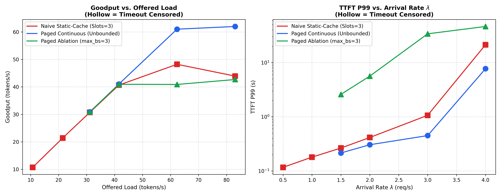

# Part 3: Empirical Serving Evaluation: Isolating Concurrency Through Ablation

In systems benchmarking, claiming that a custom architecture provides a "2× to 3× speedup" is often an artifact of unequal memory budgets, divergent batch limits, or uncalibrated workload generators.

In this evaluation, we enforce an exact mathematical capacity invariant between static batching and paged continuous batching, and use an **ablation study** to isolate the mechanism of throughput gains.

---

## The Capacity Invariant: 768 Tokens

To ensure a scientifically defensible benchmark, the serving systems were constrained to the exact same physical KV memory budget of **9.0 MiB**:
$$\text{Naive Slots} = \lfloor 9.0 \times 1024^2 / (2 \times 24 \times 2 \times 64 \times 2 \times 256) \rfloor = 3\text{ slots} \times 256\text{ MSL} = \mathbf{768\text{ tokens}}$$
$$\text{Paged Blocks} = \lfloor 9.0 \times 1024^2 / (2 \times 24 \times 2 \times 64 \times 2 \times 16) \rfloor = 48\text{ blocks} \times 16\text{ tok/block} = \mathbf{768\text{ tokens}}$$

Both engines hold identical peak token capacity. Any divergence in serving capacity stems solely from **memory management and scheduling efficiency**.

---

## The Three Serving Curves

We evaluated three configurations under identical Poisson request traces across arrival rates $\lambda \in [0.5, 4.0]$:
1. **Naive Static Cache (Red)**: Pre-allocates a fixed slot for the full 256 MSL. Max 3 concurrent requests.
2. **Paged Continuous Unbounded (Blue)**: Allocates 16-token physical blocks on-demand. Concurrency is limited only by available blocks in the pool.
3. **Paged Ablation capped at `max_batch_size=3` (Green)**: Uses paged attention and continuous batching, but artificially restricts active concurrency to 3 requests.



---

## What the Data Establishes

### 1. Equal Below Saturation
At arrival rates $\lambda \le 2.0$, all three systems behave identically. Throughput matches the offered arrival rate, and P99 TTFT remains low (0.2–0.4 s).

### 2. The Saturation Ceiling and the Ablation
At $\lambda \ge 3.0$, the offered load surpasses the capacity of static slots:
* **Naive Static Serving plateaus at 43.4 to 48.5 tok/s**.
* **Paged Ablation (`max_batch_size=3`) plateaus at 40.0 to 43.4 tok/s**, landing directly on the static ceiling.
* **Paged Unbounded breaks through to 56.4 to 65.6 tok/s**, sustaining **1.2 to 1.5× higher throughput**.

| Arrival Rate $\lambda$ | Seed | Offered Load | Naive Static | Paged Ablation (BS=3) | Paged Unbounded | Throughput Advantage |
| :---: | :---: | :---: | :---: | :---: | :---: | :---: |
| $\lambda = 3.0$ | 42 | 67.08 tok/s | 48.55 tok/s | 41.80 tok/s | **65.62 tok/s** | **1.35×** |
| $\lambda = 3.0$ | 43 | 57.54 tok/s | 47.91 tok/s | 39.97 tok/s | **56.43 tok/s** | **1.18×** |
| $\lambda = 4.0$ | 42 | 89.44 tok/s | 44.46 tok/s | 43.38 tok/s | **64.78 tok/s** | **1.46×** |
| $\lambda = 4.0$ | 43 | 76.72 tok/s | 43.40 tok/s | 42.00 tok/s | **59.22 tok/s** | **1.36×** |

> **The Core Insight**: Because Paged (BS=3) matches Naive Static, the 1.2 to 1.5× gain does not come from kernel execution speedups. It comes entirely from **memory efficiency enabling higher live sequence concurrency** within the same 768-token budget.

---

## Latency & Backpressure Dynamics

At $\lambda=4.0$:
* **Naive Static** suffers severe head-of-line blocking as incoming requests queue waiting for 1 of 3 fixed slots to free. P99 TTFT degrades to **2.05 – 2.30 s**.
* **Paged Unbounded** interleaves new prefill iterations with ongoing decode steps, maintaining P99 TTFT at **0.65 – 0.68 s** (a **3 to 3.5× improvement** in initial token response time).

---

## Reproducing the Results

The entire benchmark dataset and reproduction pipeline are packaged in the repository:
```bash
# Regenerate the publication figures from validated data:
python benchmarks/reproduce_figures.py
```
Output figures and raw logs are located in `results/`.
